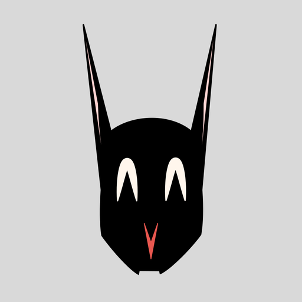

<p align="center">
  
</p>

<h1 align="center">Neko Lyrics</h1>

<p align="center">
  Word-by-word lyrics for your Mac: over your desktop, over the lock screen, and inside a glass music player.<br>
  Works with the <b>Music</b> app and <b>Spotify</b>. Menu bar app, macOS 14 or newer.
</p>

---

## What it does

- **Lyrics, word by word.** Real word timing when a source has it, a syllable-based estimate when it doesn't.
- **Lots of looks.** Poster, Stack, Rise, Electric, Constellation, Sway, Karaoke, Fisheye, Ship and more
  (see [Lyric styles](#lyric-styles)). Songs with only line timing automatically get a whole-line look.
- **Desktop player.** A large glass window: a 3D album browser, your queue, search, and a player bar.
- **Lock screen.** The same player and lyrics above the lock screen (uses a private macOS interface, see
  [Limitations](#limitations-and-honest-notes)).
- **Edge light, live wallpaper, Dock icon ring.** All optional, all separate switches.
- **Your own lyrics.** Reads lyrics embedded in your music files, and can write the lyrics you picked back into a file.
- **iPhone viewer.** A small companion app mirrors the lyrics over your local network.

## Install

Needs macOS 14+ and the Xcode command line tools (`xcode-select --install`).

```sh
chmod +x package.sh && ./package.sh      # makes dist/"Neko Lyrics-<version>.dmg"
```

Open the `.dmg` and drag **Neko Lyrics** onto Applications. To try it without installing:

```sh
./build.sh && open "Neko Lyrics.app"
```

The app is signed ad hoc (fine for your own Mac). The first time, macOS may ask you to open it from
System Settings > Privacy & Security.

**Permissions** (macOS asks the first time they are needed):

| Permission | Why |
|---|---|
| Automation > Music / Spotify | read the song and position, control playback, read album lists and queue |
| Local Network | only for the iPhone viewer |
| Input Monitoring (optional) | only so the quit shortcut works while another app is in front |

**Uninstall:** quit from the menu, drag the app to the Trash. Optionally delete
`~/Library/Application Support/NekoLyrics` (lyrics cache and file backups). Settings are in the app's preferences
(`app.nekolyrics.mac`).

## First run

A fresh install turns on the visible features so you see something straight away: desktop player, live wallpaper,
edge light and lyrics, with the Poster style. Everything can be changed from the menu bar icon. The top row has
quick switches (Player, Wallpaper, Lyrics, Edge light, Dock icon), a red **Stop everything** button and **Quit**.

## Using the menu (three tabs)

**Lyrics** — the tick / cross for the lyrics found, **Change** (pick from other results), a per-song timing nudge,
embed the lyrics into the file, edit them, and options such as *Romanize lyrics* and *Whole-line effect for line-timed songs*.

**Look** — lyric style, stack motion, font family / weight / size, colours (or *Auto Sync* from the album cover),
background, album card beside the lyrics, and the edge light (thickness, glow, corner radius).

**Desktop** — player window level, which parts show (controls, album browser on the desktop / on the lock screen),
dragging, live wallpaper, clock, Dock icon, lock-screen options and the lock-screen log.

### The player

- **Album browser** — your own library's albums, artist's albums first. Drag, two-finger swipe or mouse wheel to glide; click
  the middle cover to see its songs.
- **Play a song** — click a song in the list or search results to play it. (Apple Music cannot be queued from outside, so there is no "play next" / "add to queue".)
- **Search** — searches your Music library (switch the album source to *Store* for the online catalogue). Not available
  on the lock screen, because macOS gives other apps no keyboard there.
- **Player bar** — shuffle, previous, play/pause, next, repeat, a scrubbable progress bar, lyrics on/off, queue on/off, volume.
- **Buttons at the top right** — hide/show the controls, hide/show the album browser, allow dragging, close, quit.
- With **no lyrics** the middle shows the album browser, or just the cover if you turned the browser off.

### Timing

Press the tick when the lyrics are right. Drag the timing slider if they are a little early or late: the **last value you
set is saved for that song** and used every time. A new song starts at 0 again.

## Lyric styles

| Style | What it is |
|---|---|
| Poster | chunky words popping in a short stack, wobbling letter by letter, previous phrase floats away |
| Rise | one line at a time floats up the screen |
| Stack / Stack + icons | one word per row, the current word magnified on a marker block; motion: Swing, **Topple** (falls backward like dominoes), Turn away, Bounce, Slide |
| Electric | the current word crackles with lightning |
| **Constellation** | each word is a star that twinkles on when sung; thin lines join the words into a constellation |
| **Sway** | lines swing in from alternating sides and keep rocking back and forth |
| Classic, Karaoke, Bounce, Typewriter, Neon | line-based looks with different word effects |
| Smooth blur, Spotlight | scrolling list / one big word at a time |
| Fisheye, Ship, Visual | 3D bulge, drifting wall of lines, and icons beside matching words |
| Random per song | each song gets one of the above, the same one every time |
| Whole line (automatic) | used instead when a song only has line timing |

## Lyrics sources

In this order for each song:

1. Lyrics you picked and confirmed before (cached on your Mac, works offline).
2. Lyrics embedded in the file, or an `.lrc` file next to it.
3. **Apple Music word-timed sheets** through the public lyrics catalogue at `lyrics-api.binimum.org` (no account or key).
4. **LRCLIB** (`lrclib.net`), line-timed.

Not every song is in every source. If nothing is found, use **Change** to search again by hand.

**Romanization.** *Romanize lyrics* turns Japanese, Korean, Hindi/Nepali (Devanagari), Arabic, Russian, Thai and other
scripts into Latin letters, using macOS's own transliteration. It is a best effort: Japanese particles and kanji
readings can be off, and Chinese comes out as pinyin. It does not look for separately written romaji lyrics online.

## Queue

The Music app's scripting cannot edit Up Next, so Neko Lyrics does not try. The queue panel only shows what is coming up in
the current list; clicking a song plays it.

## Safety switches

- **Stop everything** (menu): turns every feature off and hides all windows; the app stays in the menu bar.
- **Quit** (menu), the power button on the player, or **⌃⌥⌘Q**.
- The player cannot be dragged by default so sliders and buttons always work; the hand button turns dragging on.

## Privacy

- No account, no analytics, no tracking.
- Network requests: LRCLIB and the lyrics catalogue above (song title, artist, album, length); the iTunes Search API for
  the *Store* album source and search; for Spotify, the cover image URL Spotify itself provides.
- Stored on your Mac only: `~/Library/Application Support/NekoLyrics/` holds `lyrics-cache.json` (chosen lyrics, per-song
  offsets), a one-time backup of any file you embed lyrics into, and `lockscreen.log` (diagnostics, no personal data).
- The iPhone viewer talks only over your local network.

## Limitations and honest notes

- **Lock screen** drawing uses a private macOS interface and can break with any macOS update. If it shows nothing,
  open Desktop > lock-screen log and send me `lockscreen.log`.
- The edge light follows the lyric timing, not the audio itself (real beat detection needs a system-audio permission).
- Spotify does not share its queue, so the queue panel is for the Music app.
- Word timing from the estimate is a guess; real timing comes from the Apple Music sheets or from enhanced LRC files.
- The Apple lyrics catalogue is an unofficial third-party service and can change or disappear; LRCLIB is the fallback.
- This project was written without being able to compile or run it on a Mac. Expect to fix the occasional build error;
  the Swift type checker can time out on a long expression, and splitting it into typed pieces fixes that.

## iPhone viewer

`iOS/` holds a small SwiftUI app. Create an iOS app target in Xcode, add those three files, and add the Local Network
usage description plus Bonjour services `_nekolyrics._tcp` and `_nekolyrics._udp`. Run it on the same Wi-Fi as the Mac.

## Project layout

| File | Role |
|---|---|
| `App.swift`, `SettingsView.swift` | app entry, menu bar window, first-run defaults |
| `Engine.swift` | state, settings, lyric loading, sync offset, lock / unlock handling |
| `NowPlaying.swift`, `Library.swift` | Music / Spotify playback, library, albums, queue, search |
| `LyricsProvider.swift`, `AppleLyrics.swift`, `EmbeddedLyrics.swift`, `LyricsCache.swift`, `LRC.swift` | finding, parsing and caching lyrics |
| `Styles.swift`, `NewStyles.swift`, `Overlay.swift` | lyric styles, edge light, backdrops, overlay windows |
| `DesktopPlayer.swift`, `LockScreenLayer.swift` | glass player, wallpaper, clock, Dock icon, lock-screen window |
| `AlbumArt.swift`, `WordGlyphs.swift` | colours from the cover, icons for words |
| `TagWriter.swift`, `Editor.swift` | writing lyrics into files, lyric editor |
| `PhoneSync.swift`, `Wire.swift`, `iOS/` | iPhone viewer |
| `Assets/` | logo, app icon, menu bar icon |

## Credits

Original code. Design ideas were inspired by other lyrics and player apps; no code was copied from them. The lyrics
catalogue and LRCLIB are third-party services with their own terms. The logo is the Neko mark in `Assets/`.

## v1.4.1
- Lock screen: the player reacts to the first click (progress bar scrub works).
- Album browser: related + random albums, shuffle button; playing an album builds an ordered playlist and plays it; queue and play commands run on the main thread and report the real error from Music.
- Cover flips when the album changes and glides from centre to the left when lyrics appear.

## v1.4.2
- Live wallpaper no longer vanishes after a song change: it waits 3 s before fading out and a late fade-out can no longer hide a wallpaper that was just shown again.

## v1.4.3
- Backgrounds now work with the player open: the player draws the Background you chose (Transparent, Dim, Color gradient, Album cover, Animated colors, Cover + animated, Full-screen artwork). Before, only the desktop lyrics window drew it, and that window is hidden while the player is open.
- Random font per song (Look > Font).
- Edge light redrawn as a soft glow from four eased gradient strips (no blur, no sparks) that always follows the album cover colors, even with Auto Sync off.

## v1.4.4
- Player is the plain see-through glass panel again (no fixed background painted behind it); backgrounds apply to the full-screen lyrics view.
- Edge light ignores colors with no hue (black / white / grey read as red before) and uses neutral light for black-and-white covers.

## v1.4.5
- Lyric / highlight colors are chosen from inline swatches (the system color panel popped up in odd places); picking one turns Auto Sync off.
- Helper playlists ("Neko Lyrics Queue", "Neko Lyrics Album") can be switched off and deleted from Settings.
- Constellation: every line gets its own shape (zig-zag, arc, wave, diagonal, scatter, ring) and stars fly in from different directions.

## v1.4.6
- Lyric / highlight colors: full inline picker (square + hue bar + swatches), no system color panel.
- Settings are no longer hidden behind the player or overlays (they step down while the menu is open).
- Background "Transparent" now also keeps the live wallpaper off, so nothing is painted.
- Big clock has its own window and no longer depends on the wallpaper or playback.

## v1.4.7
- The edge-light / lyrics overlay sits below the menu bar (above it only on the lock screen), so the menu-bar icon and settings are always reachable while the player is on.

## v1.5.0
- Removed "Play next", "Add to queue", "Play album" and the helper playlists. Apple Music cannot be queued from outside (its scripting has no Up Next), and the playlist workaround was unreliable. Clicking a song now simply plays it; albums open as a song list; "Show in Music" opens the album in Music.

## v1.5.1
- Player window buttons are one faint circle (top right) that opens on hover into: lyrics on/off, controls on/off, album browser on/off, drag lock, minimise, quit. It fades back after you move away.

## v1.5.2
- Rise style: a long line that wraps onto two rows no longer runs into the next line; neighbours are placed using the real (estimated) height of each line.
- Smooth, Fisheye and Ship: a line too long for two rows gets a smaller font so it never runs into its neighbours.

## v1.5.3
- The player stays on every desktop (Space) again, including in the default "normal" window level.

## v1.5.4
- Sync offset slider now covers ±15 s (was ±3 s), with ±0.1 / ±1 s buttons (up to ±60 s) and a Reset.

## v1.5.5
- Long pauses: the app now keeps asking the player while paused (a missed notification left it thinking nothing played), opts out of App Nap, and rebuilds its windows after sleep, wake or a screen change.

## v1.5.6
- Songs without lyrics: the album card and the song title/artist (with the lyrics status) still show, instead of an empty screen.

## v1.5.7
- After unlocking, the overlays and the player are rebuilt (windows moved above the lock screen stopped appearing on every desktop), and the lock-screen layer is only used while actually locked.

## v1.5.8
- Fixed periodic flashing: windows are no longer re-framed / re-ordered, and the clock is no longer rebuilt, on every refresh; polling stays silent when nothing changed.

## v1.6.0
- Light by design: no App Nap override, no wake/rebuild logic, no extra polling while paused.
- The app quits by itself after music has been paused (or stopped) for a minute. Open it again when you resume.
- The big clock is removed completely.

## v1.6.1
- Word-by-word upgrade: lyrics from a file's tags or an earlier line-timed search are swapped for Apple's word-by-word version when it exists (unless you confirmed a choice for that song).

## v1.6.2
- No more emoji in lyrics: the picture-words (Visual styles) use only clean SF Symbols, and the icon styles are left out of 'Random per song'.

## v1.6.3
- Picture-words are colour-coded SF Symbols with a soft glow (heart red, sun yellow, water blue, ...), and many more words have one.

## v1.6.4
- Songs without lyrics: the cover sits in the middle with the song and artist under it; no 'lyrics not found' text.

## v1.6.5
- Video backgrounds: one shared decoder per video (was one per place it was shown), capped at 720p, paused while music is paused, released when its window is gone.
